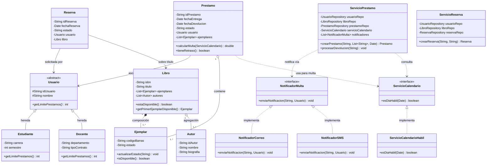

# Taller de Programación Orientada a Objetos y Arquitectura de Software
## Sistema de Gestión de Préstamos de Biblioteca Universitaria


Sistema integral de gestión de préstamos, devoluciones, cálculo de multas y reservas para una biblioteca universitaria. Desarrollado en **Java 17+** sobre **Spring Boot 3**, aplicando rigurosamente **Arquitectura Limpia (Clean Architecture)** y los **Principios de Diseño SOLID**.

---

## 🏛 Arquitectura del Sistema

La solución implementa una **Arquitectura Limpia por Capas Concéntricas**, desacoplando totalmente las reglas de negocio de cualquier detalle tecnológico o de infraestructura.

```
       ┌────────────────────────────────────────────────────────┐
       │             Infraestructura (Infrastructure)           │
       │  Adapters: Repositorios en Memoria, Notificadores,     │
       │            Servicio Calendario, Runner Demo Spring     │
       │  ┌──────────────────────────────────────────────────┐  │
       │  │               Aplicación (Application)           │  │
       │  │  Casos de Uso: ServicioPrestamo, ServicioReserva │  │
       │  │  ┌────────────────────────────────────────────┐  │  │
       │  │  │               Dominio (Domain)             │  │  │
       │  │  │  Modelos: Usuario, Estudiante, Docente,    │  │  │
       │  │  │           Libro, Ejemplar, Autor, Prestamo │  │  │
       │  │  │  Puertos: Repositorios, Notificador,       │  │  │
       │  │  │           ServicioCalendario               │  │  │
       │  │  │  Excepciones de Negocio                    │  │  │
       │  │  └────────────────────────────────────────────┘  │  │
       │  └──────────────────────────────────────────────────┘  │
       └────────────────────────────────────────────────────────┘
```

### 1. Capa de Dominio (`domain`)
- **Modelos (`domain.model`)**: Contiene las entidades puras y la lógica de negocio intrínseca. No tiene dependencias de Spring ni de frameworks externos.
- **Puertos (`domain.port`)**: Define las interfaces que representan los contratos requeridos por el dominio para interactuar con el exterior (repositorios, servicios de notificación, calendario).
- **Excepciones (`domain.exception`)**: Excepciones de dominio tipadas que modelan los errores del negocio.

### 2. Capa de Aplicación (`application`)
- **Servicios (`application.service`)**: Orquestadores de casos de uso (`ServicioPrestamo`, `ServicioReserva`). Coordinan el flujo entre las entidades del dominio y los puertos, asegurando el cumplimiento de las reglas transaccionales sin acoplarse a implementaciones concretas.

### 3. Capa de Infraestructura (`infrastructure`)
- **Adaptadores**: Implementaciones concretas de los puertos del dominio:
  - `infrastructure.persistence`: Repositorios en memoria (`InMemory*Repository`).
  - `infrastructure.notification`: Canales de comunicación (`NotificadorCorreo`, `NotificadorSMS`).
  - `infrastructure.calendar`: Determinación de días laborales (`ServicioCalendarioHabil`).
  - `infrastructure.config`: Configuración de Spring Boot y runner de demostración (`BibliotecaRunner`).

---

## 🧩 Cumplimiento de Principios SOLID

| Principio | Aplicación en el Proyecto |
| :--- | :--- |
| **S - Single Responsibility** | Cada clase tiene una única responsabilidad bien definida: `Prestamo` calcula multas, `Ejemplar` gestiona su estado, `ServicioCalendario` analiza fechas hábiles y los notificadores se dedican exclusivamente a su medio de difusión. |
| **O - Open/Closed (OCP)** | El sistema de notificaciones (`NotificadorMulta`) y el calendario (`ServicioCalendario`) están abiertos a la extensión pero cerrados a la modificación. Se pueden incorporar nuevos canales (WhatsApp, Push) o calendarios de festivos sin modificar `ServicioPrestamo`. |
| **L - Liskov Substitution** | `Estudiante` y `Docente` extienden de `Usuario` y pueden ser utilizados de manera indistinta y polimórfica en cualquier punto del sistema sin romper la lógica del negocio. |
| **I - Interface Segregation** | Se definen puertos específicos y cohesivos (`UsuarioRepository`, `LibroRepository`, `PrestamoRepository`, `ReservaRepository`, `NotificadorMulta`, `ServicioCalendario`) en lugar de interfaces monolíticas. |
| **D - Dependency Inversion** | Los servicios de aplicación dependen exclusivamente de interfaces/puertos declarados en el dominio. Spring IoC inyecta las implementaciones de infraestructura en tiempo de ejecución. |

---

## 📊 Diagrama de Clases UML



---

## 📋 Matriz de Requerimientos de la Solución

| Requerimiento | Descripción | Implementación y Justificación en el Código |
| :---: | :--- | :--- |
| **R1** | **Herencia y Polimorfismo en Usuarios** | Clase abstracta `Usuario` con método abstracto `getLimitePrestamos()`. `Estudiante` retorna `3` préstamos y `Docente` retorna `5`. |
| **R2** | **Composición vs. Agregación** | `Libro` contiene **composición** estricta de sus `Ejemplar` (su ciclo de vida está ligado al libro) y **agregación** de `Autor` (los autores existen independientemente de los libros). |
| **R3** | **Máquina de Estados en Ejemplar** | `Ejemplar` encapsula su estado (`DISPONIBLE`, `PRESTADO`) mediante `actualizarEstado(nuevoEstado)` con validaciones y método `isDisponible()`. |
| **R4** | **Validación y Gestión de Préstamos** | `ServicioPrestamo.crearPrestamo` valida que el total de ejemplares activos más los nuevos no supere el límite polimórfico del usuario, lanzando `LimitePrestamosSuperadoException`. |
| **R5** | **Cálculo de Multas por Días Hábiles** | `Prestamo.calcularMulta(ServicioCalendario)` calcula la mora recorriendo los días del atraso y sumando únicamente los días hábiles laborales ($2.500 COP por día hábil por ejemplar). |
| **R6** | **Notificaciones Polimórficas (OCP)** | `NotificadorMulta` desacopla el envío de alertas. Se implementan `NotificadorCorreo` y `NotificadorSMS`. Spring inyecta la lista completa automáticamente. |
| **R7** | **Sistema de Reservas** | `ServicioReserva.crearReserva` solo permite reservar si `!libro.estaDisponible()`. Si hay ejemplares disponibles, rechaza la operación lanzando `LibroDisponibleException`. |
| **Reto** | **Arquitectura Limpia y Pruebas** | Separación en capas `domain`, `application` e `infrastructure`, inversión de dependencias y suite completa de pruebas unitarias con JUnit 5 y Mockito. |

---

## 📂 Estructura del Código Fuente

```text
com.biblioteca
├── application
│   └── service
│       ├── ServicioPrestamo.java              # Orquestación de préstamos y devoluciones
│       └── ServicioReserva.java               # Orquestación de reservas de libros
├── domain
│   ├── exception
│   │   ├── BibliotecaException.java          # Excepción base del dominio
│   │   ├── LibroDisponibleException.java      # Lanzada al reservar si hay disponibilidad
│   │   ├── LibroNoDisponibleException.java    # Lanzada al intentar préstamo sin ejemplares
│   │   ├── LimitePrestamosSuperadoException.java # Lanzada al exceder cupo del usuario
│   │   └── RecursoNoEncontradoException.java  # Entidad no encontrada
│   ├── model
│   │   ├── Autor.java                         # Entidad de autor
│   │   ├── Docente.java                       # Subclase Usuario (límite: 5)
│   │   ├── Ejemplar.java                      # Ejemplar físico con estados
│   │   ├── Estudiante.java                    # Subclase Usuario (límite: 3)
│   │   ├── Libro.java                         # Título bibliográfico y agregados
│   │   ├── Prestamo.java                      # Préstamo y cálculo de mora hábil
│   │   ├── Reserva.java                       # Reserva sobre libro no disponible
│   │   └── Usuario.java                       # Clase base abstracta polimórfica
│   └── port
│       ├── LibroRepository.java               # Puerto persistencia libros
│       ├── NotificadorMulta.java              # Puerto de notificación polimórfico
│       ├── PrestamoRepository.java            # Puerto persistencia préstamos
│       ├── ReservaRepository.java             # Puerto persistencia reservas
│       ├── ServicioCalendario.java            # Puerto para verificación de días hábiles
│       └── UsuarioRepository.java             # Puerto persistencia usuarios
└── infrastructure
    ├── calendar
    │   └── ServicioCalendarioHabil.java       # Implementación que excluye fines de semana
    ├── config
    │   ├── BibliotecaApplication.java         # Clase principal Spring Boot
    │   └── BibliotecaRunner.java              # Demostración interactiva de escenarios
    ├── notification
    │   ├── NotificadorCorreo.java             # Canal de notificación por Email
    │   └── NotificadorSMS.java                # Canal de notificación por SMS
    └── persistence
        ├── InMemoryLibroRepository.java       # Persistencia en memoria
        ├── InMemoryPrestamoRepository.java    # Persistencia en memoria
        ├── InMemoryReservaRepository.java     # Persistencia en memoria
        └── InMemoryUsuarioRepository.java     # Persistencia en memoria
```

---

## 🚀 Guía de Ejecución

### Prerrequisitos
- **Java Development Kit (JDK)**: Versión 17 o superior instalada.
- **Maven**: 3.8+ o utilizar el wrapper incluido (`mvnw` / `mvnw.cmd`).

### 1. Compilación del Proyecto
```bash
./mvnw clean compile
# En Windows PowerShell / CMD:
.\mvnw.cmd clean compile
```

### 2. Ejecución de Pruebas Unitarias
Ejecuta la suite de pruebas unitarias de las capas de Dominio y Aplicación:
```bash
./mvnw test
# En Windows PowerShell / CMD:
.\mvnw.cmd test
```

### 3. Ejecución de la Aplicación y Demostración
Inicia la aplicación de Spring Boot. Al arrancar, el componente `BibliotecaRunner` ejecuta automáticamente los tres escenarios demostrativos:
```bash
./mvnw spring-boot:run
# En Windows PowerShell / CMD:
.\mvnw.cmd spring-boot:run
```

---

## 🧪 Escenarios Demostrativos Ejecutados en el Runner

Al iniciar la aplicación, `BibliotecaRunner` ejecuta paso a paso el siguiente flujo visible en consola:

1. **Escenario 1 — Verificación de Disponibilidad**:
   - Se consulta el libro *"Clean Code"*, el cual tiene todos sus ejemplares en estado `PRESTADO`.
   - Se valida que `libro.estaDisponible()` retorna `false`.

2. **Escenario 2 — Intento de Préstamo y Creación de Reserva**:
   - La estudiante *Ana García* intenta solicitar un préstamo directo de *"Clean Code"*.
   - El sistema rechaza la solicitud lanzando `LibroNoDisponibleException`.
   - Inmediatamente se canaliza la solicitud hacia `ServicioReserva.crearReserva()`, generando una reserva exitosa en estado `PENDIENTE`.

3. **Escenario 3 — Devolución Vencida, Multa Hábil y Notificaciones Multi-canal**:
   - El docente *Prof. Carlos Mendoza* realiza la devolución del libro *"Design Patterns"* con 5 días de retraso calendario (3 días hábiles).
   - Se procesa la devolución calculando la multa exacta sobre los días hábiles laborables ($15.000 COP).
   - Se disparan en paralelo las notificaciones por **Correo Electrónico** y **SMS** mediante las implementaciones de `NotificadorMulta`.
   - Se verifica que el préstamo queda en estado `DEVUELTO` y todos los ejemplares retornan a estado `DISPONIBLE`.

---

## 👨‍💻 Autor
- **Juan Sebastián Martelo**
- Taller de Programación Orientada a Objetos y Arquitectura de Software
